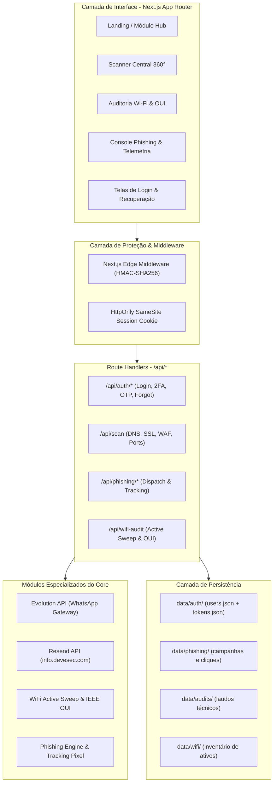
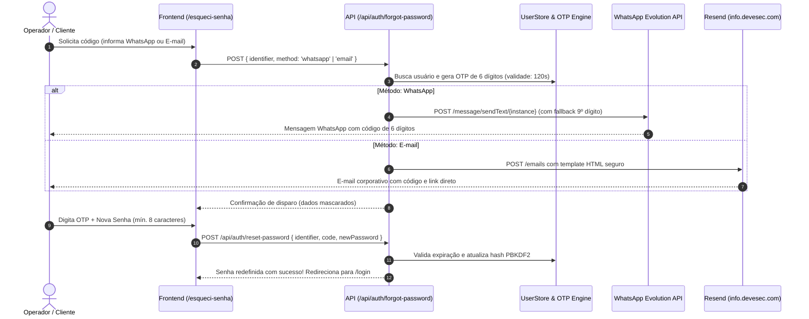

# 🛡️ ARQUITETURA DE SISTEMA: DEV & SEC SUITE 2.0
> **Plataforma Modular de Inteligência Cibernética, Auditoria Ofensiva e Hardening Defensivo**  
> *Versão:* 2.0 (Pronta para Comercialização / Produto SaaS Enterprise)  
> *Data de Documentação:* Novembro de 2026

---

## 1. Visão Geral e Estratégia de Produto

O **DEV & SEC Intelligence Suite 2.0** foi projetado como uma plataforma modular de alta performance voltada tanto para auditorias corporativas quanto para a oferta comercial como produto de software (SaaS).

A plataforma separa rigorosamente:
1. **Modo Visitante / Demonstração Pública**: Permite que potenciais clientes conheçam a plataforma, testem um scan externo rápido de portas/DNS e visualizem o catálogo de recursos.
2. **Modo Assinante / Operador Pro**: Acesso restrito via autenticação militar com **2FA** aos módulos de varredura profunda de rede interna, simulação ativa de phishing corporativo, auditoria de código (SAST) e cálculo de passivo da LGPD.

```mermaid
graph TD
    User([Usuário / Cliente]) --> Entrypoint{Acesso à URL}
    Entrypoint -->|Visitante Não Autenticado| PublicRoutes[Rotas Públicas: /, /scanner demo, /docs, /phishing/treinamento]
    Entrypoint -->|Tentativa de Acesso Pro| MiddlewareGuard[Next.js Middleware Edge Guard]
    MiddlewareGuard -->|Sem Sessão Ativa| LoginFlow[/login com Redirecionamento ?from=]
    LoginFlow -->|WhatsApp / E-mail OTP| 2FAEngine[Desafio 2FA / Recuperação]
    2FAEngine -->|Sessão Válida| PrivateRoutes[Módulos Pro: /wifi, /phishing admin, /cloud, /secrets, /comparator, /mobile, /social-engineering]
```

---

## 2. Matriz de Controle de Acesso (RBAC & Guard)

| Rota | Classificação | Objetivo Comercial & Acesso |
|---|---|---|
| `/` | **Público** | Landing Page comercial, demonstração visual dos 8 módulos e status da suíte. |
| `/scanner` | **Público (Demo)** | Reconhecimento de superfície externa (DNS, SSL, Portas Públicas e SPF/DMARC). |
| `/docs` | **Público** | Guia técnico, catálogo de defesas e especificações de conformidade. |
| `/phishing/treinamento` | **Público (Landing)** | Tela educativa *Just-in-Time* para colaboradores que clicam nos testes simulados. |
| `/api/phishing/track` | **Público (Telemetria)**| Coleta de abertura de 1x1 pixel e clique sem exigir login da vítima. |
| `/login` | **Público** | Autenticação com e-mail, senha e suporte a desafio 2FA. |
| `/esqueci-senha` | **Público** | Recuperação de credenciais via WhatsApp (Evolution API) e E-mail (Resend). |
| `/wifi` | **PRO (Protegido)** | Auditoria Layer 2/RF 802.11, varredura `/24`, OUI IEEE real e Wifite/Aircrack. |
| `/phishing` | **PRO (Protegido)** | Console administrativo: criação de campanhas, disparo em massa e telemetria HVR. |
| `/cloud` | **PRO (Protegido)** | Auditoria CSPM de Buckets S3/Azure Blobs e checklist CIS Foundations. |
| `/secrets` | **PRO (Protegido)** | Motor SAST de vazamento de credenciais (AWS, GitHub, JWT, Stripe) no código. |
| `/mobile` | **PRO (Protegido)** | Auditoria estática de arquivos APK Android e regras OWASP Mobile Top 10. |
| `/social-engineering`| **PRO (Protegido)** | Inteligência OSINT Dark Web, monitoramento de vazamentos e Whaling C-Level. |
| `/comparator` | **PRO (Protegido)** | Calculadora financeira FAIR de ROI, passivo evitado de multas LGPD e laudo executivo. |

---

## 3. Arquitetura Full-Stack

A aplicação é construída com **Next.js 14 App Router**, unificando frontend e backend em uma base de código tipada em TypeScript com zero mock em rotas de produção.



---

## 4. Engenharia de Autenticação & Recuperação (WhatsApp & E-mail)

### A. Criptografia e Armazenamento de Senhas
- As senhas dos operadores não são armazenadas em texto claro.
- Utiliza **PBKDF2** (Password-Based Key Derivation Function 2) com algoritmo digestivo **SHA-512**, **salt criptográfico exclusivo de 16 bytes** por usuário e **10.000 iterações**.
- A verificação de senha utiliza comparação em tempo constante (`crypto.timingSafeEqual`) para imunidade contra ataques de temporização (*Timing Attacks*).

### B. Gestão de Sessão (Stateless JWT-Like)
- Emissão de cookie `devesec_session` com assinatura **HMAC-SHA256**.
- Flag `HttpOnly = true` (bloqueia furto de token via ataques XSS no navegador).
- Flag `SameSite = Lax` e `Secure = true` em produção (mitigando CSRF).
- Validação instantânea no Edge Runtime do Middleware sem sobrecarregar o disco.

### C. Fluxo de Redefinição com OTP (120 Segundos)



---

## 5. Módulos com Telemetria e Dados Reais

### 1. Auditoria Wi-Fi & Redes Locais (`/wifi`)
- **Varredura Ativa de Rede**: Disparo de varredura dual-pass na sub-rede `/24` combinando ICMP Ping, acordamento de portas UDP 137 (NetBIOS) e 5353 (mDNS multicast `224.0.0.251`), seguido de leitura da tabela ARP do sistema operacional (`Get-NetNeighbor`).
- **Resolução OUI IEEE 802.3**:
  - Detecção do bit U/L (Universal/Local) no primeiro octeto do endereço MAC. Se o segundo dígito for `2, 6, A, E`, classifica o dispositivo como **MAC Privado / Aleatorizado** (típico de iPhones com iOS 14+ e Android 10+).
  - Consulta ao banco OUI e fallback assíncrono à API oficial IEEE (`api.maclookup.app`).

### 2. Simulador de Phishing & Treinamento Just-in-Time (`/phishing`)
- **Disparo Real**: Envio homologado via **Resend API** e **Nodemailer SMTP** com o subdomínio `info.devesec.com` (DKIM, SPF e MX configurados e com relatório DMARC do Google validado).
- **Pixel 1x1 e Links Tokenizados**: Cada e-mail contém um token criptográfico único (`tk_...`) associado ao destinatário.
- **Coleta de Telemetria**:
  - `GET /api/phishing/track?act=open&tk=...` -> Entrega GIF transparente 1x1 e registra abertura.
  - `GET /api/phishing/track?act=click&tk=...` -> Registra clique, atualiza taxa de vulnerabilidade humana (HVR) e redireciona (HTTP 302) para a página educativa `/phishing/treinamento`.
  - `GET /api/phishing/track?act=report&tk=...` -> Registra reporte do colaborador consciente.

---

## 6. Topologia de Produção para Deploy em VPS

Para hospedar o **DEV & SEC Suite 2.0** na sua VPS Linux (Ubuntu/Debian), a arquitetura recomendada é:

```
                  ┌───────────────────────────────┐
                  │    Internet (Clientes/Alvos)  │
                  └───────────────┬───────────────┘
                                  │ HTTPS (Porta 443)
                                  ▼
             ┌─────────────────────────────────────────┐
             │       Nginx Reverse Proxy + SSL         │
             │       (Certbot Let's Encrypt / HSTS)    │
             └─────────────┬───────────────────────────┘
                           │ Proxy Pass http://localhost:3000
                           ▼
             ┌─────────────────────────────────────────┐
             │    Next.js 14 App (PM2 Process Manager) │
             │   - SSR / Client Components             │
             │   - Edge Runtime Middleware             │
             │   - REST API Route Handlers             │
             └──────┬───────────────────────┬──────────┘
                    │                       │
      (Chamadas API │         (Chamadas API │
       HTTPS seguras)          HTTPS seguras)
                    ▼                       ▼
    ┌───────────────────────┐  ┌─────────────────────────┐
    │  Resend API           │  │  WhatsApp Evolution API │
    │  (info.devesec.com)   │  │  (Instância VPS / Port) │
    └───────────────────────┘  └─────────────────────────┘
```

---

## 7. Guia de Migração para Banco de Dados MySQL no Deploy Final

Atualmente, todos os módulos de storage (`user-store.ts`, `phishing-store.ts`, `audit-store.ts`, `wifi-store.ts`) estão desacoplados em interfaces limpas de TypeScript sob a pasta `src/core/storage/`.

Quando você for subir a aplicação na VPS e desejar plugar o **MySQL**:

1. **Instalação do Prisma ORM**:
   ```bash
   bun add -d prisma
   bun add @prisma/client
   bunx prisma init --datasource-provider mysql
   ```

2. **Schema Declarativo (`prisma/schema.prisma`)**:
   ```prisma
   datasource db {
     provider = "mysql"
     url      = env("DATABASE_URL")
   }

   generator client {
     provider = "prisma-client-js"
   }

   model User {
     id                 String   @id @default(uuid())
     name               String
     email              String   @unique
     phone              String?
     passwordHash       String
     salt               String
     role               String   @default("OPERATOR")
     twoFactorEnabled   Boolean  @default(false)
     twoFactorMethod    String   @default("whatsapp")
     createdAt          DateTime @default(now())
     updatedAt          DateTime @updatedAt
   }

   model OtpToken {
     id         String   @id @default(uuid())
     identifier String
     code       String
     type       String
     expiresAt  DateTime
     used       Boolean  @default(false)
     createdAt  DateTime @default(now())
   }

   model PhishingCampaign {
     id            String   @id
     title         String
     organization  String
     status        String
     recipients    Json
     stats         Json
     createdAt     DateTime @default(now())
   }
   ```

3. **Substituição das Funções do Store**:
   - As funções `findUserByEmail`, `createOtpToken`, `verifyOtpToken`, `savePhishingCampaign` receberão a chamada `await prisma.user.findUnique(...)` sem que nenhuma linha do frontend ou das rotas de API precise ser alterada.

---

## 8. Resumo das Credenciais e Ambientes de Teste

- **Ambiente Local**: `http://localhost:3000`
- **Usuário Padrão (Seed)**: `contato@devesec.com` (ou `admin@devesec.com`)
- **Senha Padrão Inicial**: `DevSec2025!@`
- **Integração WhatsApp**: Evolution API via `EVOLUTION_API_URL`
- **Integração E-mail**: Resend API via `info.devesec.com` com DKIM/SPF ativo
